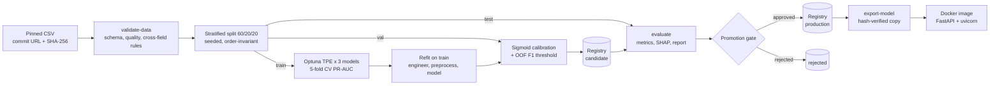

# tabular-ml-pipeline

A strictly reproducible, end-to-end tabular ML pipeline for **customer churn**
(IBM Telco dataset). It covers a pinned dataset, a validated data contract,
leakage-free features, multi-model tuning, calibration, a SHA-256 model registry with
a promotion gate, and a FastAPI service that returns calibrated probabilities with
**SHAP reason codes** and **input-drift warnings**. The service ships as a multi-stage
CPU Docker image.

## Results

The full pipeline was run on the pinned dataset (seed 42, 60/20/20 stratified split).
Numbers are copied from [`results/report.md`](results/report.md) and
[`results/metrics.json`](results/metrics.json).

| Model | CV ROC-AUC | CV PR-AUC | Val PR-AUC | Val F1 | Test ROC-AUC | Test PR-AUC | Test F1 | Test Brier | Threshold |
|---|---|---|---|---|---|---|---|---|---|
| Logistic regression (baseline) | 0.8530 ± 0.0195 | 0.6675 ± 0.0354 | 0.6053 | 0.6159 | 0.8397 | 0.6445 | 0.6317 | 0.1388 | 0.300 |
| LightGBM | 0.8544 ± 0.0216 | 0.6738 ± 0.0405 | 0.6202 | 0.6102 | 0.8473 | 0.6653 | 0.6352 | 0.1354 | 0.351 |
| **XGBoost (champion, in production)** | 0.8556 ± 0.0199 | **0.6785 ± 0.0371** | 0.6250 | 0.6222 | 0.8469 | **0.6682** | **0.6368** | 0.1372 | 0.262 |

How to read the table:
- **CV** columns are 5-fold cross-validation on the train split. The champion is
  chosen on these alone.
- **Val** columns use out-of-fold calibrated probabilities on the validation split.
- **Test** columns are hold-out results, reported for every model. They played no
  part in selection.

On test, the champion flags 277 of 374 churners (recall 0.741, precision 0.559) at
the F1-optimal threshold. The confusion matrix is TN 816 / FP 219 / FN 97 / TP 277.

What the numbers say:
- **Gradient boosting buys about +1 point of PR-AUC over a tuned linear model.** That
  gain is inside one CV standard deviation, which is typical for Telco churn: the
  signal is mostly additive (contract type, tenure, internet service).
- The gate still promoted XGBoost because its PR-AUC beat the baseline's on every
  split (CV, validation, and test) and it cleared every floor. Logistic regression is
  a defensible alternative if interpretability or latency matters more.
- **All three models are well calibrated** after sigmoid calibration on the
  validation split, with test Brier scores of 0.135–0.139. The reliability table is
  in the report.
- **Top global drivers** (mean |SHAP|, log-odds): `Contract` 0.67, `tenure` 0.51,
  `InternetService` 0.25, `PaymentMethod` 0.17, `TechSupport` 0.17.
- **The data has a hard ceiling.** 40 customers share every feature with another
  customer, and 18 of those groups carry opposite labels. No model can separate them.

## Architecture



Each split is used for exactly one purpose:

| Split | Used for | Never used for |
|---|---|---|
| **train** (60%) | CV tuning, model fit, SHAP background, drift reference ranges | calibration, threshold, selection on hold-out |
| **val** (20%) | calibrator fit, decision threshold (out-of-fold) | tuning, model fit |
| **test** (20%) | final metrics, promotion gate, benchmark reporting | any choice made during training |

`tests/test_pipeline.py` swaps `X_test` for a frame full of the string `"POISON"` and
checks that training still succeeds, which proves training never reads the test split.

## Quickstart

Requires [uv](https://docs.astral.sh/uv/). Docker is only needed for the image. No
`make` is needed: `tasks.py` is a standard-library task runner, and the `Makefile`
only forwards to it.

```bash
uv sync --locked                       # Python 3.12 venv with exact pinned versions
uv run python tasks.py check           # ruff + mypy --strict + LF check + 208 offline tests
uv run python tasks.py pipeline        # validate-data -> train (~80 s) -> evaluate
uv run python tasks.py serve           # API on http://127.0.0.1:8000 (docs at /docs)
```

Docker:

```bash
uv run python tasks.py docker-build    # export the production model + build the image
uv run python tasks.py docker-smoke    # run it, check /health and /predict, remove it
uv run python tasks.py docker-run      # serve on :8000
```

<details><summary>All tasks</summary>

| Task | What it does |
|---|---|
| `sync` | Create/refresh `.venv` exactly from `uv.lock` |
| `format` / `lint` / `typecheck` | ruff format, ruff check + format check, `mypy --strict` |
| `eol` | Fail if any text file contains a CR byte |
| `test` / `test-network` / `coverage` | Offline suite / real-dataset test / coverage report |
| `check` | `lint` → `typecheck` → `eol` → `test` |
| `validate-data` / `train` / `evaluate` / `pipeline` | Pipeline stages, or all three in order |
| `serve` | Local API from the registry's production model |
| `export-model` | Hash-verified copy of the production model to `build/model` |
| `docker-build` / `docker-run` / `docker-smoke` | Build, run, or smoke-test the image |
| `clean` | Remove tool caches (never data, artifacts, or results) |

Pass extra arguments with `--`, for example
`uv run python tasks.py train -- --max-trials 5`. With make: `make train ARGS="--max-trials 5"`.
</details>

## API

| Method & path | Purpose |
|---|---|
| `GET /health` | `200 {"status": "ok", ...}` when a model is loaded; `503 {"status": "unavailable"}` otherwise |
| `GET /model-info` | Model id, stage, threshold, artifact SHA-256, git commit, CV/val/test metrics, feature schema with training ranges |
| `POST /predict?top_k=3` | One customer: calibrated probability, decision, SHAP reason codes, drift warnings |
| `POST /predict/batch?top_k=3` | Up to 1,000 customers, returned in the order given |

```bash
curl -s http://127.0.0.1:8000/health
curl -s http://127.0.0.1:8000/model-info

curl -s -X POST http://127.0.0.1:8000/predict \
  -H "Content-Type: application/json" -H "X-Request-ID: demo-1" \
  -d @examples/customer.json

curl -s -X POST "http://127.0.0.1:8000/predict/batch?top_k=5" \
  -H "Content-Type: application/json" -d @examples/batch.json
```

A real `POST /predict` response from the production model:

```json
{
  "customer_id": "7590-VHVEG",
  "churn_probability": 0.771875,
  "churn_prediction": true,
  "threshold": 0.261702,
  "reasons": [
    {"feature": "tenure", "value": 2.0, "contribution": 0.692825, "direction": "increases_risk"},
    {"feature": "Contract", "value": "Month-to-month", "contribution": 0.545172, "direction": "increases_risk"},
    {"feature": "InternetService", "value": "Fiber optic", "contribution": 0.238089, "direction": "increases_risk"}
  ],
  "warnings": [],
  "model_id": "20261126T012827Z-37ac9766-8c8c-xgboost",
  "latency_ms": 146.8
}
```

- **Reason codes** are SHAP values of the model's log-odds score. One-hot columns are
  summed back into their source feature (`Contract`, not `Contract__month_to_month`),
  which is valid because SHAP values are additive. Tests assert that the contributions
  plus the base value reproduce the model margin exactly, for all three model
  families. Calibration is a monotonic map, so the direction and ranking of reasons
  carry over to the probability.
- **Drift warnings** flag values that are valid under the schema but outside what the
  model saw in training, for example
  `tenure=100 is outside the training range [0, 72]`. They also flag categories the
  training split never contained.
- **Strict validation returns 422** for any of the following:
  - missing or extra fields;
  - unknown categories;
  - `"12"` or `12.0` for `tenure` (a JSON integer *is* accepted for float fields);
  - booleans for `SeniorCitizen`;
  - out-of-bounds values or NaN/Infinity (the 422 body stays valid JSON: non-finite
    inputs are echoed back as strings);
  - impossible combinations, such as `PhoneService="No"` with
    `MultipleLines="Yes"`, or `InternetService="No"` with an add-on other than
    `"No internet service"`.

  These cross-field rules live in `config.py` and are enforced identically on the
  training data. A test fails if the request model ever drifts from the config schema.
- **Operations:**
  - Every response carries `X-Request-ID` (echoed if it's safe, otherwise generated)
    and `X-Process-Time-Ms`.
  - Every request is logged with method, path, status, and latency. Every prediction
    is logged with model id, probability, and warning count.
  - Measured steady-state latency on a laptop CPU is a median of **79 ms** for a
    single prediction (p95 162 ms) and **1.35 ms per row** in batches of 100. Single
    requests are dominated by fixed per-call overhead (pandas plus SHAP); batching
    amortizes it. The example above shows a first request, which includes warm-up.

CLI equivalents: `ml-pipeline predict examples/batch.json -o preds.json` accepts the
same JSON. It also accepts a raw Telco CSV such as `data/raw/telco_customer_churn.csv`,
validated leniently and with the same tenure-0 rule as training. Other commands:
`ml-pipeline evaluate --fail-on-reject` (exit code 3 on rejection, for CI) and
`ml-pipeline export-model --dest build/model`.

## Model registry & promotion gate

```
artifacts/registry/
  registry.json                 production pointer, stage of every model, event log
  models/<model_id>/model.joblib
  models/<model_id>/metadata.json
```

`metadata.json` records:
- the artifact's **SHA-256** and size;
- the git commit and dirty flag, config fingerprint, seed, dataset SHA-256, content
  hash, and per-split ID hashes;
- library versions and the full schema;
- best hyperparameters, CV/val/test metrics, threshold, and the full promotion
  decision.

The artifact is **hash-verified before it is unpickled**, so a tampered or corrupted
`model.joblib` is refused and never deserialized (`joblib.load` can execute code). The
SHAP explainer is not pickled; it is rebuilt from the stored pipeline when loaded.

A candidate is promoted only if **all** of these hold on the test split:

| Check | Rule (current value) |
|---|---|
| `roc_auc_floor` | test ROC-AUC ≥ 0.82 |
| `pr_auc_floor` | test PR-AUC ≥ 0.61 |
| `f1_floor` | test F1 ≥ 0.56 |
| `brier_ceiling` | test Brier ≤ 0.17 |
| `not_worse_than_baseline` | primary metric ≥ the baseline's test PR-AUC − 0.01, which vetoes a complex model that clearly loses to logistic regression |
| `beats_production` | primary metric ≥ the **current production model re-scored on the same test split** + margin |

The floors are **derived, not hand-picked**. `registry.suggest_promotion_floors` turns
the tuned baseline's evidence into floors before any test metric exists:
- AUC floor = baseline CV mean − 2 × CV std × √(fold rows / test rows), a 2σ lower
  bound at test-set size.
- F1 floor = baseline out-of-fold validation F1 − 0.05.
- Brier ceiling = baseline out-of-fold validation Brier + 0.02.

`ml-pipeline train` prints the suggestions next to the configured values. A promoted
model archives the previous one, and the history is kept in `registry.json`.
Re-running `evaluate` on an already decided run reuses the recorded decision.

## Reproducibility & leakage guarantees

- **Pinned data:** the download uses an immutable commit URL and is checked against
  its SHA-256 (`16320c9c…3e55e91`) before use. It is streamed to a temp file and moved
  into `data/raw/` only after the checksum matches.
- **Data contract** (`data.py`):
  - Every column is read as raw text and parsed against a typed schema.
  - **All** violations are collected into one error: structure, types, ranges,
    categories, cross-field rules, missing rates, duplicate IDs, labels, and class
    balance.
  - One row-local rule is applied: `TotalCharges` is blank exactly for the 11
    `tenure == 0` customers (not yet billed), so it is set to 0.
- **Split before fitting:** the split is stratified, seeded, and taken after sorting
  by ID, so it doesn't depend on file row order. Every learned statistic lives inside
  a single sklearn `Pipeline`. `tests/test_data_leakage.py` proves this in three ways:
  - It recomputes imputer, clipper, and scaler statistics from training rows alone,
    and shows that a poisoned hold-out *would* have shifted them.
  - A spy transformer checks the rows each fold sees during `cross_validate`.
  - A mutation check confirmed the test fails when leakage is injected.
- **Determinism:**
  - Optuna runs sequential seeded TPE (a per-model seed, so models don't share
    draws).
  - Every estimator is single-threaded and seeded. CV folds run in parallel, which
    doesn't change results.
  - The SHAP masker is explicit (shap's default silently subsamples the background).
  - A test retrains from scratch and asserts identical hyperparameters, CV scores,
    thresholds, and predictions.
- **Lineage:** the config fingerprint hashes every setting that can change a model.
  Output paths, promotion gates, and serving limits are deliberately excluded, so
  re-deriving the gates does not invalidate a trained model. `evaluate` refuses to
  score a run on data or splits that differ from the ones it was trained on.

## Design trade-offs

- **The baseline is a serious competitor.** Logistic regression is within one CV std
  of the boosters. The extra 1–2 points of PR-AUC cost interpretability and some
  latency. The gate allows the trade but vetoes a complex model that clearly loses to
  the baseline.
- **Threshold chosen on out-of-fold calibrated validation probabilities.** Choosing it
  on the same probabilities the calibrator was fit on would give an optimistic F1.
  F1 (β=1) is the configured objective. A retention team with cheap interventions
  might prefer F2 (`threshold_beta=2`) to trade precision for recall.
- **Sigmoid calibration rather than isotonic:** about 1.4k validation rows is enough
  for isotonic regression but gives a step function, and Brier scores were already
  0.135–0.139. Isotonic is one config switch away.
- **SHAP on the uncalibrated margin.** This is exact and additive in log-odds, but the
  units aren't probability points. It's documented in the API rather than
  approximated.
- **Drift warnings, not rejections.** Schema bounds reject *impossible* values. Values
  that are merely *unfamiliar* are served with a warning, so callers decide what to
  do. Population-level drift monitoring (PSI or KS over time) would be the next step.
- **File-based registry.** It is simple, diffable, and has no server. It assumes a
  single writer; a team setup would move to MLflow or a database-backed registry.
- **Lean image (742 MB, mostly scikit-learn, SciPy, LightGBM, XGBoost and SHAP):**
  - `xgboost-cpu` avoids about 200 MB of CUDA/NCCL dependencies.
  - Optuna lives in a `train` dependency group that is excluded from the image.
  - Base images are pinned by tag **and** digest.
  - The container runs as a non-root user with a `HEALTHCHECK` on `/health`.

## Engineering standards

- Exact `==` pins in `pyproject.toml` plus `uv.lock`, Python 3.12.
- `ruff` (including bandit rules) and `mypy --strict` with the pydantic plugin across
  source, tests, and the task runner.
- **LF everywhere:**
  - every report, registry file, and prediction file is written by
    `io_utils.atomic_write_*` (temp file, `fsync`, `os.replace`, `newline="\n"`);
  - `.gitattributes` sets `eol=lf`;
  - `tasks.py eol` fails the build on any CR byte.
- 209 tests: 208 offline (on schema-faithful synthetic data, including a full
  train → evaluate → promote → serve run in about 30 s) and 1 that uses the real
  downloaded dataset.

## Layout

```
src/ml_pipeline/
  config.py      frozen pydantic config: dataset pin, schema + cross-field rules, splits,
                 features, search spaces, promotion gates, serving limits, fingerprint
  data.py        fetch + verify, parse + validate, stratified split
  features.py    domain features, QuantileClipper, ColumnTransformer, pipelines
  train.py       Optuna CV tuning, calibration, OOF threshold, champion, registration
  evaluate.py    test metrics, reliability, SHAP global/local, gate, metrics.json/report.md
  registry.py    SHA-256 artifacts, lineage, promotion gate, lifecycle, export
  model.py       ChurnModel: calibrated pipeline + threshold + SHAP + drift reference
  metrics.py     shared metric definitions, ECE, reliability, threshold selection
  schemas.py     strict API request/response models
  api.py         FastAPI app factory
  cli.py         typer CLI: validate-data, train, evaluate, serve, predict, export-model
  io_utils.py    atomic LF writes, canonical JSON, hashing
tests/           leakage, validation, features, pipeline, registry, API, CLI, config, I/O
examples/        request bodies for curl and ml-pipeline predict
results/         committed reports: data_validation.json, metrics.json, report.md
```

## License

MIT © 2026 Omar Hazem. The dataset is IBM's Telco Customer Churn sample (Apache-2.0).
